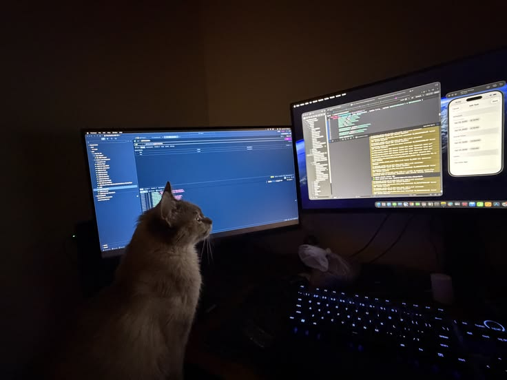

# Shafin

### AI/ML Engineer · Generative AI · Data Science · Python Developer

  

  
  
  

---

### About

Computer Science Engineering graduate with a strong interest in Artificial Intelligence, Machine Learning, and intelligent software systems.

I enjoy exploring how data, algorithms, and modern AI technologies can come together to solve practical problems. My interests span machine learning, data science, Generative AI, and backend development.

Currently expanding my knowledge of LLM-powered applications, Retrieval-Augmented Generation (RAG), and modern AI engineering workflows.

---

### Technical Skills

**Languages**

  

**AI, Machine Learning & Data Science**

  
  
  
  

**Generative AI & LLM Engineering**

  
  
  
  
  

**Backend & Databases**

  

**Tools & Platforms**

  
  

---

### Currently Exploring

- Retrieval-Augmented Generation (RAG) architectures
- LangChain and LLM application development
- Embeddings, vector databases, and semantic search
- AI agents and tool calling
- Building scalable backend services for AI applications
- Machine Learning and intelligent data-driven systems

---

### GitHub Activity

  
  

  

---

  <i>Curiosity drives learning. Building turns it into impact.</i>

